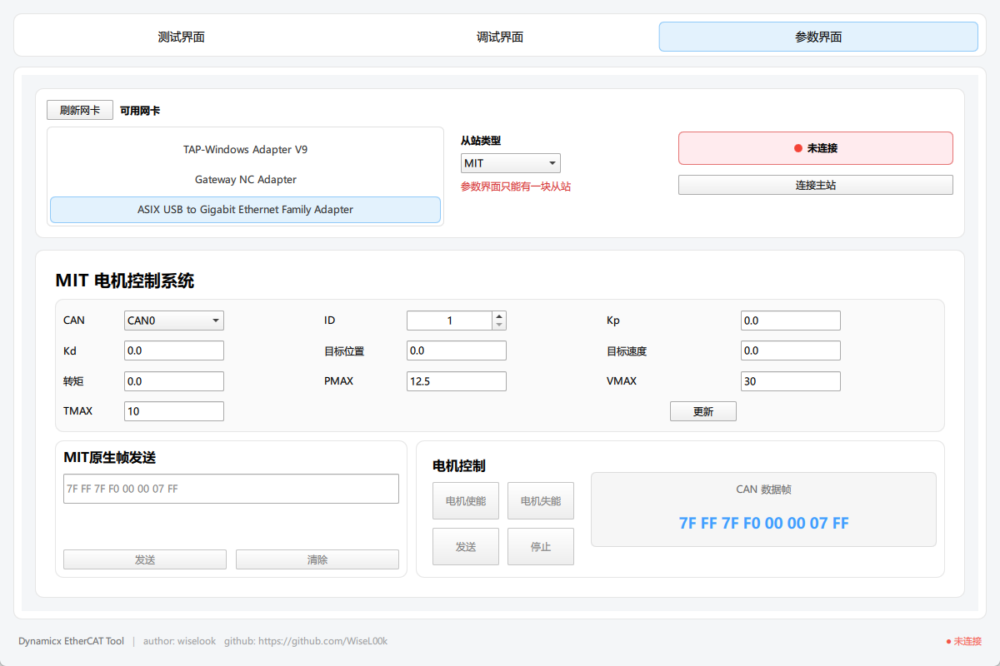

DynamicxEcatTool 是在上位机侧调试 EtherCAT 设备的桌面工具：选网卡、连从站、看通信状态、烧 EEPROM、给电机下发参数，都在一个界面里完成。主站通信基于 [SOEM](https://github.com/OpenEtherCATsociety/SOEM)，设备和从站配置用 YAML 描述，由 `yaml-cpp` 解析。

已在 Windows 11 和 Ubuntu 20.04 上测试。

## 三个页签

- **测试界面**：刷新并选择网卡，连接或停止 EtherCAT 测试流程，状态灯显示当前连接状态；实时查看运行日志；选择从站地址和 `.hex` 文件烧录 EEPROM，并显示进度和结果。
- **调试界面**：连接或断开主站，加载 YAML 配置；按从站分组列出电机的 CAN Bus、CAN ID 和在线状态，集中输出调试日志。
- **参数界面**：选择从站类型（目前是 MIT），配置 Kp、Kd、目标位置、目标速度、转矩以及 PMAX / VMAX / TMAX，也可以直接发送原生 CAN 数据帧。离线时会自动禁用参数下发，避免误操作。

(widths: [480, 720, 1024], sizes: "(min-width: 760px) 720px, 100vw")

## 结构

- `Backend/`：业务逻辑。`Config` 解析配置，`Ethercat` 负责主站、从站与 SDO 控制，`Monitor` 监控在线状态，`Flash` 负责 EEPROM 和固件烧录，另外还有数据模型、网卡服务和电机命令的封装。
- `SOEM_interface/`：封装 SOEM 的主站总线、从站基类、错误处理和工具接口。
- `qml/`：主窗口、各功能页面、通用控件、对话框、主题切换和 MIT 电机参数面板。

构建时后端先编译成 `dynamicx_backend` 静态库，再与 QML 应用和 `SOEM_interface` 链接成最终的可执行文件。

## 构建

依赖 CMake 3.16+、C++17 编译器、Qt6（Core、Quick、QuickControls2）和 `yaml-cpp`。仓库包含 SOEM 子模块，第一次拉取后要先初始化：

```bash
git submodule update --init --recursive
cmake -S . -B build
cmake --build build -j
```

访问网卡需要权限：Windows 上以管理员身份运行，Ubuntu 上用 `sudo` 运行。
