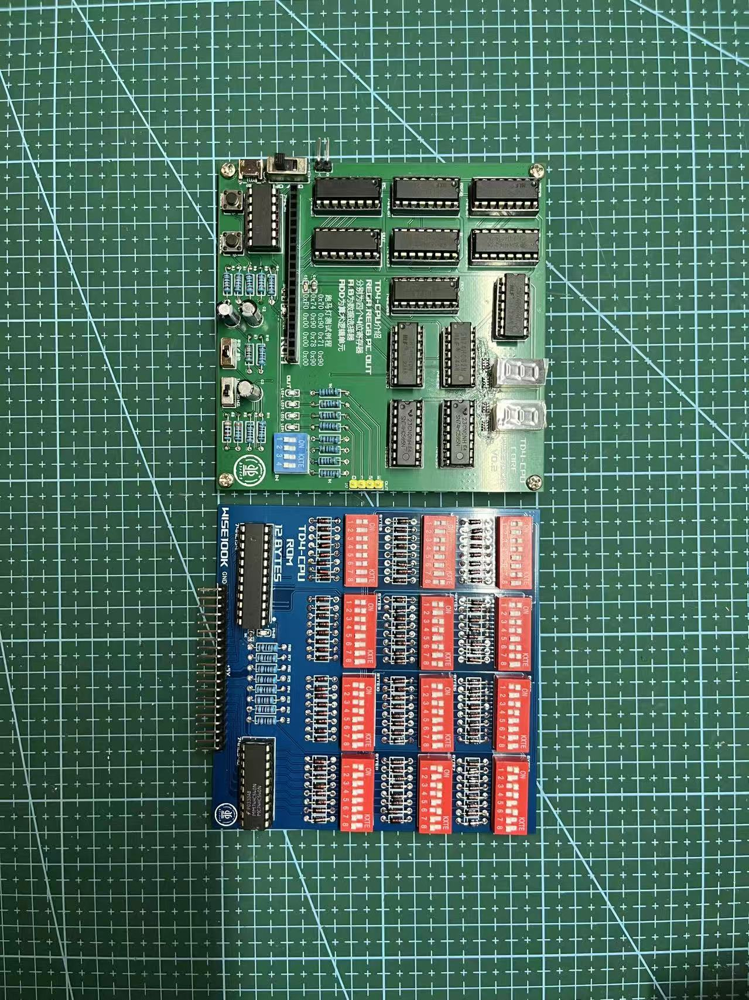
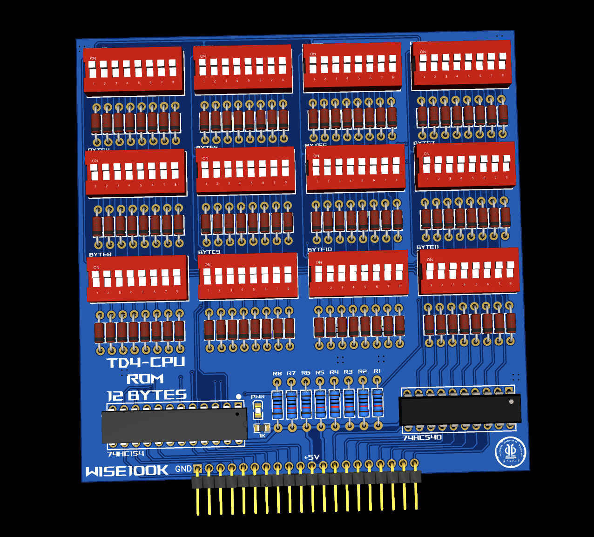

参考经典的 TD4 设计做的一块 4 位 CPU。主板和 ROM 板都是自己画的 PCB，寄存器、数据选择器和加法器全部用 74HC 系列逻辑芯片搭出来，程序靠拨码开关一位一位"写"进 ROM。

(widths: [480, 720, 1024], sizes: "(min-width: 760px) 720px, 100vw", quality: 76)

## 硬件

- **主板**：REGA、REGB、PC、OUT 是四个 4 位寄存器（74HC161）；A、B 两个数据选择器（74HC153）决定 ALU 的数据来源；ADD（74HC283）是算术逻辑单元。输出接 4 个 LED 和两位数码管，时钟可以在手动单步和 1 Hz / 10 Hz 自动之间切换。
- **ROM 板**：12 字节，每个字节是一组 8 位拨码开关；地址由 74HC154 译码，数据经 74HC540 输出。

(widths: [480, 720, 1024], sizes: "(min-width: 760px) 720px, 100vw")

## 指令集

每条指令 8 位：高 4 位是操作码，低 4 位是立即数 `Im`。

| 指令 | 高 4 位 | 低 4 位 |
| :-- | :-: | :-: |
| `ADD A, Im` | `0000` | `Im` |
| `MOV A, B` | `0001` | `0000` |
| `IN A` | `0010` | `0000` |
| `MOV A, Im` | `0011` | `Im` |
| `MOV B, A` | `0100` | `0000` |
| `ADD B, Im` | `0101` | `Im` |
| `IN B` | `0110` | `0000` |
| `MOV B, Im` | `0111` | `Im` |
| `OUT B` | `1001` | `0000` |
| `OUT Im` | `1011` | `Im` |
| `JZ Im` | `1110` | `Im` |
| `JMP Im` | `1111` | `Im` |

SEL_A、SEL_B 两路信号选择 ALU 的数据源，`#LOAD0`–`#LOAD3` 选择结果写入哪个寄存器，也就是分别控制源操作数和目的操作数。

## 测试程序

一个不断加 1 并输出的小程序：

```text
0000 0001    ADD A, 1
0100 0000    MOV B, A
1001 0000    OUT B
1111 0000    JMP 0
```

完整的指令真值表、跑马灯和数码管示例见 [仓库 README](https://github.com/WiseL00k/My_TD4CPU)。
